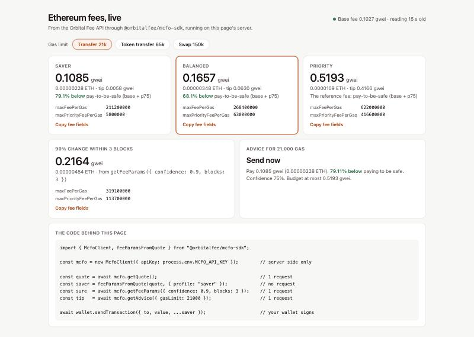

# @orbitalfee/mcfo-sdk

[](https://github.com/OrbitalFee/mcfo-sdk/actions/workflows/ci.yml)
[](https://github.com/OrbitalFee/mcfo-sdk/actions/workflows/live.yml)
[](https://www.npmjs.com/package/@orbitalfee/mcfo-sdk)
[](LICENSE)

Fee selection for Ethereum and Bitcoin transactions from [Orbital Fee](https://mcfo.zgos.eu).

Two layers, both usable on their own:

1. **`McfoClient`** — typed access to `/v1/quick`, `/v1/advice/save` and
   `/v1/advanced`, plus `getFeeParams()` which returns EIP-1559 values in wei;
   and for Bitcoin, `btcQuick()`, `btcProviders()` and `btcHistory()` with the
   measured next-block odds passed through as the API serves them.
2. **`sendTransaction()`** — merges those fees into a transaction and hands it
   to *your* ethers `Signer` or viem `WalletClient` for signing and submission.

**The SDK never handles private keys.** Signing and submission stay with
your own wallet client. Key management and autonomous submission are out of
scope.

## Install

```bash
npm install @orbitalfee/mcfo-sdk
# plus whichever client you already use:
npm install ethers      # or: npm install viem
```

Node 18+ (uses the global `fetch`). Use the SDK on a server: the Orbital Fee
API does not answer cross-origin requests from browsers, and an API key must
never be shipped to a browser anyway. The [dashboard example](#a-live-dashboard)
shows the pattern: the SDK on your server, your page talks to your server. Both `ethers` and `viem` are *optional*
peer dependencies — the SDK depends on neither at runtime, only on their
public method shapes.

## Fee parameters only

```ts
import { McfoClient } from "@orbitalfee/mcfo-sdk";

const mcfo = new McfoClient({ apiKey: process.env.MCFO_API_KEY }); // anonymous = free tier

const fees = await mcfo.getFeeParams({ profile: "saver" });
// { maxFeePerGas: 40100000000n, maxPriorityFeePerGas: 100000000n, source: {...} }

await wallet.sendTransaction({ to, value, ...fees }); // your wallet, your keys
```

Profiles map onto `/v1/quick`'s tiers: `saver` → slow, `balanced` → normal
(default), `priority` → fast. `maxFeePerGas` carries headroom for base-fee
growth — `baseFee × baseFeeMultiplier + tip`, multiplier 2 by default.

Need all three profiles? Fetch the quote once and derive them, so one request
does the work of three:

```ts
import { McfoClient, feeParamsFromQuote } from "@orbitalfee/mcfo-sdk";

const quote = await mcfo.getQuote();
const saver = feeParamsFromQuote(quote, { profile: "saver" });
const fast = feeParamsFromQuote(quote, { profile: "priority" });
```

For confidence-targeted pricing (`/v1/advanced`), pass `confidence` and/or
`blocks` instead of a profile:

```ts
const fees = await mcfo.getFeeParams({ confidence: 0.95, blocks: 2 });
```

## Bitcoin

```ts
const q = await mcfo.btcQuick({ vsize: 140 }); // vsize of your transaction, default 140

q.marketState;             // "floored" | "contested" | "flat"
q.tiers.priority.satVb;    // the rate to pay, after the tier's relay floor
q.tiers.priority.usd;      // for your vsize at the stored price; null without a fresh price
q.tiers.priority.landsNextBlockPct;      // measured share that made the very next block
q.tiers.priority.landsWithin6BlocksPct;  // and within six blocks (about an hour)
q.reliability;             // the measurement behind those odds (see below)
```

The odds are **measured, never computed by the SDK**. `reliability` carries the
measurement they come from: `measuredOn`, `window`, `quotesScored`,
`blocksScored`, `basis` (`floored`, `aboveFloor` or `all` — the population that
matches the current market state) and `stale`, which turns true thirty days
after the measurement. Read `stale` before showing a percentage: an expired
measurement is still served, so you can judge it, but it describes a market
that may have moved. A tier without a measured figure has no
`landsNextBlockPct` at all; the SDK never fills one in.

In a **floored** market the whole queue clears below the relay floor, every
tier is its floor (production: Priority 1 sat/vB, Balanced and Saver 0.4) and
`blocks` is `null`, because three prices at the floor cannot carry three
different block counts. `rawSatVb` keeps the queue's own rate beside the
floored one. In a **contested** market the tiers differ, each carries the
virtual block it clears in and only the measured tier carries odds.

```ts
const providers = await mcfo.btcProviders(); // mempool.space, Blockstream, blockchain.com beside our rate
providers.queueAvailable;                    // false during a mempool.space outage; the other rows stay

const day = await mcfo.btcHistory();              // last 1440 minutes, oldest first, ts in epoch seconds
const week = await mcfo.btcHistory({ minutes: 10080 });
```

`btcHistory()` returns `[]` only for a window with no rows. A read failure is a
503 (`McfoError` code `feed_stale`, the message names
`btc_history_unavailable`), never an empty list, so a broken read cannot be
drawn as a flat line at zero. `depth` on the quote is weight at or above each
rate — a vector by design; a mempool total is not served.

## With submission

```ts
import { McfoClient, sendTransaction } from "@orbitalfee/mcfo-sdk";

const { hash, feeParams } = await sendTransaction(
  mcfo,
  signer,                       // ethers Signer or viem WalletClient
  { to: "0x…", value: 10n ** 16n },
  { profile: "balanced" },
);
```

Fees you set explicitly on the transaction always win — the SDK only fills
gaps. If the API is unavailable the call throws **before** anything is sent,
so a transaction is never submitted unpriced.

## Behind a login (Cloudflare Access)

The hosted API is behind Cloudflare Access. A program that calls it needs a service token, which the owner issues. Pass its two values as extra headers:

```ts
const mcfo = new McfoClient({
  headers: {
    "CF-Access-Client-Id": process.env.CF_ACCESS_CLIENT_ID!,
    "CF-Access-Client-Secret": process.env.CF_ACCESS_CLIENT_SECRET!,
  },
});
```

The examples and the live tests read `CF_ACCESS_CLIENT_ID` and `CF_ACCESS_CLIENT_SECRET` from the environment. The `headers` option never overrides `accept`, `content-type` or `X-API-Key`. Without a token, the login page comes back instead of JSON, and the client raises `McfoError` with the code `http_error`.

## Errors

Every failure is an `McfoError` with a `code`:

| code | meaning |
|---|---|
| `feed_stale` | 503 — a feed is stale or a read failed (`feed_stale`, `feed_unavailable`, `btc_history_unavailable` in the message); `retryAfterSeconds` is set |
| `rate_limited` | 429 — tier limit hit; `retryAfterSeconds` from `Retry-After` |
| `invalid_api_key` | 401 — key unknown or revoked |
| `invalid_param` | 422 — `param` names the offending field |
| `http_error` / `network_error` | anything else / transport failure |

## Examples

Each example runs from a clone of this repository after `npm ci && npm run build`.
Inside the repository `@orbitalfee/mcfo-sdk` resolves to the local build, so the
files run unchanged in your own project after `npm install @orbitalfee/mcfo-sdk`.

| Example | What it shows |
|---|---|
| [`examples/quick-fees.mjs`](examples/quick-fees.mjs) | The three profiles from the live API, in gwei and wei, with typed error handling |
| [`examples/dry-run-transaction.mjs`](examples/dry-run-transaction.mjs) | `sendTransaction` with a recording wallet: confidence pricing, and a fee you set yourself winning over the SDK's |
| [`examples/dashboard/`](examples/dashboard/) | A live fee dashboard, below |

### A live dashboard

```bash
npm ci && npm run build
node examples/dashboard/server.mjs      # then open http://localhost:8787
```



A Node server with no dependencies besides the SDK. It reads the live API on the
server (three requests every 15 seconds, shared by every open tab, so a busy page
stays inside the free tier's 30 a minute) and serves one page with:

- the Saver, Balanced and Priority fees, their cost for the chosen gas limit, and
  the `maxFeePerGas` / `maxPriorityFeePerGas` values ready to copy into a transaction;
- the fee for a 90% chance of inclusion within 3 blocks;
- the advice (send now or wait) for the chosen gas limit;
- the last good reading and the reason when the API is unavailable or rate-limited.

Set `MCFO_API_KEY` to use a paid tier; the key stays on the server.

## Tests

```bash
npm test               # everything below except the live suite
npm run test:unit      # unit and contract tests
npm run test:coverage  # the same, failing below 95% line/function and 90% branch coverage
npm run test:package   # pack, install, import by name, type-check a TypeScript consumer
npm run test:live      # against the real API (needs network)
```

| Suite | What it proves |
|---|---|
| `test/client.test.js` | Fee arithmetic, headers, and the mapping of every API error to `McfoError` |
| `test/send.test.js` | Fees merged into the transaction, delegation to ethers and viem, your own fees always win |
| `test/contract.test.js` | Responses recorded from the live API replayed through the client, with every derived wei value checked exactly; proxy pages, timeouts and unknown statuses become typed errors |
| `test/package.test.js` | What `npm install` delivers: the tarball contents, the exports, and the shipped type declarations |
| `test/live.test.js` | Invariants of the real API (fresh snapshot, ordered tiers, usable EIP-1559 values). Skipped unless `MCFO_LIVE=1` |

CI runs the unit tests on Node 18, 20 and 22, then coverage and the package test.
The live suite runs every day. A red "Live API" badge means the API changed or is
down, not that the SDK broke.

No test framework: Node's built-in runner, against the compiled output, so the
only development dependency is TypeScript.

## License

MIT. See [LICENSE](LICENSE).
